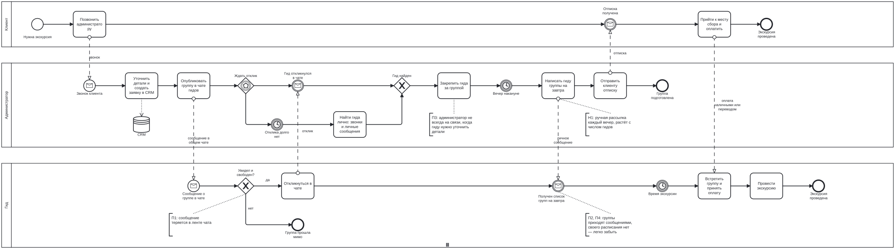
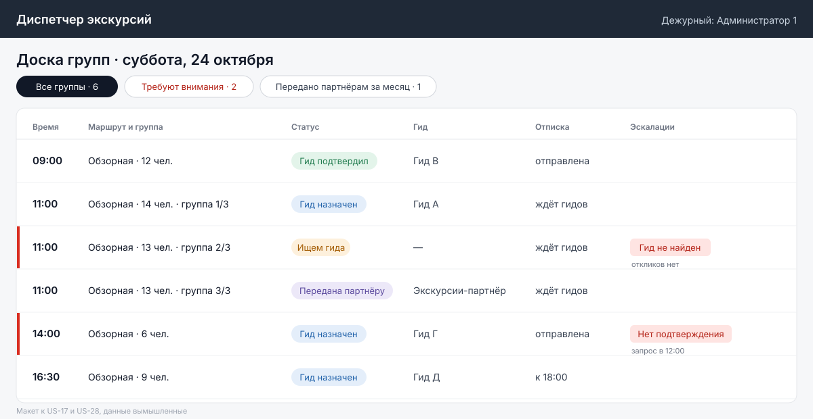

# Диспетчер экскурсий

[](https://github.com/KORTEZZ12/excursion-dispatch/actions/workflows/spec-checks.yml)

Портфолио системного аналитика: полный цикл аналитики сервиса для экскурсионной службы — от интервью с гидами до исполнимой спецификации, которую проверяет CI.

Сервис координирует гидов. Заявка из amoCRM превращается в группы, гиды получают предложения в Telegram-боте, система напоминает им о группах, накануне готовит администратору отписку для клиента и зовёт дежурного, когда что-то пошло не так.

**Статус:** итерации 1 и 2 из 4 — исследование, требования, системный дизайн — и независимое ревью. Следующий шаг — MVP первого релиза. [CHANGELOG](CHANGELOG.md).

## Автор и роль

Кирилл Фадеев, системный аналитик. Я сам работаю гидом, поэтому доменные правила взяты из практики, а боли проверены на интервью с коллегами: 3 администратора и 12 гидов.

Что делал я: исследование, интервью и опрос гидов, решения D-01–D-18, ревью черновиков, приёмку. Решения по MVP подтвердил владелец службы — [протокол встречи](docs/research/meetings/2026-10-28-owner.md). Черновики артефактов и независимое ревью делают ИИ-агенты, роли и границы — в [устройстве работы](docs/00-process.md).

## Если у вас 5 минут

1. **Как исследование изменило решение.** Правило «кто первым откликнулся» 10 из 12 гидов назвали нечестным: Telegram у всех работает через VPN с разной задержкой. Его заменило окно откликов, а как выбирать гида внутри окна, решили сами гиды в опросе: жребий среди откликнувшихся — [D-11 и D-17](docs/decisions/decision-log.md), [ADR-002](docs/decisions/adr/ADR-002-response-window.md).
2. **Независимое ревью и что с ним сделано.** 42 замечания, 12 критических, у каждого — где исправлено и что ещё ждёт заказчика — [реестр](docs/reviews/2026-10-27-iteration-2/README.md).
3. **Правила, которые проверяет база.** 32 исполняемые проверки: у гида нет пересекающихся групп, повтор нажатия не создаёт второй отклик, замена гида не наследует подтверждение — [модель данных](docs/design/data-model.md).
4. **Процессы под Camunda 8.8** — [BPMN](docs/bpmn), проходят линтер Camunda без замечаний.
5. **Контракт API** с каталогом ошибок и реакцией панели на каждую — [документация в браузере](https://kortezz12.github.io/excursion-dispatch/api/).

## Проблема

Группы доходят до гидов через общий Telegram-чат и личные сообщения администраторов. Сообщение о назначении уезжает вверх в личной переписке, гиды забывают про группы, а группы достаются тем, у кого быстрее доходят уведомления. [AS-IS](docs/research/as-is.md).

## Что показало исследование

- Группы теряются не в общем чате, как я предполагал, а в личной переписке с администратором: так забывали группу 9 из 12 гидов.
- На вечерние сообщения гидам у администраторов уходит 2–2,5 часа в день.
- Как выбирать гида, если откликнулись несколько, гиды решили сами в опросе: 24 из 32 против гонки, большинство из них — за жребий.
- Около 6 групп в месяц передают партнёрам, потому что гид не нашёлся.

Что в данных ещё не сходится и как это проверяем — в [итогах исследования](docs/research/findings.md#что-не-сходится-и-как-проверяем).



## Как устроено

[Архитектура](docs/design/architecture.md) — бот, панель, планировщик, очередь отправки, PostgreSQL, интеграции с amoCRM и Telegram. Доска администратора:



## Надёжность

Решения, о которых обычно спрашивают в финтехе и на нагруженных проектах:
- **Идемпотентность.** Все изменяющие запросы панели — с `Idempotency-Key`: повтор после обрыва связи возвращает первый результат, а не ошибку. Вебхуки дедуплицируются по ключу события и `update_id`.
- **Конкурентные правки.** `ETag` и `If-Match` в API, раунды поиска и исключающие ограничения в базе: одно нажатие — одно действие, и только в своём раунде.
- **Inbox и outbox.** Вебхук amoCRM сохраняется и обрабатывается асинхронно, данные — из API ([ADR-001](docs/decisions/adr/ADR-001-webhook-as-signal.md)). Сообщения в Telegram уходят через очередь с ограничением скорости, пределом попыток и сроком годности.
- **Тихий отказ.** Если сводка не ушла к 19:05, администраторы получают тревогу не через Telegram (NFR-16).

## Карта артефактов

| Артефакт | Где | Версия |
|---|---|---|
| Как устроена работа | [docs/00-process.md](docs/00-process.md) | 0.2 |
| AS-IS и боли | [docs/research/as-is.md](docs/research/as-is.md), [схема](docs/bpmn/as-is-dispatch.bpmn) | 0.2 |
| Гипотезы, гайд, итоги и протоколы интервью | [docs/research](docs/research) | 0.5 |
| Видение, метрики, бизнес-кейс, релизы | [docs/requirements/vision.md](docs/requirements/vision.md) | 0.5 |
| Бизнес-правила и параметры | [docs/requirements/business-rules.md](docs/requirements/business-rules.md) | 0.5 |
| Бэклог с критериями приёмки | [docs/requirements/backlog.md](docs/requirements/backlog.md) | 0.5 |
| Нефункциональные требования | [docs/requirements/nfr.md](docs/requirements/nfr.md) | 0.4 |
| Глоссарий | [docs/requirements/glossary.md](docs/requirements/glossary.md) | 0.5 |
| Журнал решений | [docs/decisions/decision-log.md](docs/decisions/decision-log.md) | 0.5 |
| ADR | [docs/decisions/adr](docs/decisions/adr) | 0.5 |
| Процессы TO-BE (Camunda 8.8) | [docs/bpmn](docs/bpmn) | 0.4 |
| Архитектура и макет доски | [docs/design/architecture.md](docs/design/architecture.md) | 0.4 |
| Статусная модель группы | [docs/design/group-states.md](docs/design/group-states.md) | 0.4 |
| Модель данных, DDL, проверки | [docs/design/data-model.md](docs/design/data-model.md) | 0.5 |
| Sequence-диаграммы | [docs/design/sequences.md](docs/design/sequences.md) | 0.5 |
| OpenAPI и каталог ошибок | [docs/api](docs/api) | 0.4 |
| Интеграции: amoCRM, Telegram | [docs/integrations](docs/integrations) | 0.4 |
| Независимое ревью итерации 2 | [docs/reviews](docs/reviews/2026-10-27-iteration-2/README.md) | 27.10.2026 |
| MVP | — | итерация 3 |

## Как проверить локально

```bash
createdb ed_check
psql -d ed_check -v ON_ERROR_STOP=1 -f docs/design/ddl.sql -f docs/design/ddl-checks.sql
npx @redocly/cli@1 lint docs/api/openapi.yaml
cd tools && npm ci && node bpmn-lint.mjs ../docs/bpmn/*.bpmn && cd ..
python3 tools/check_links.py
```
