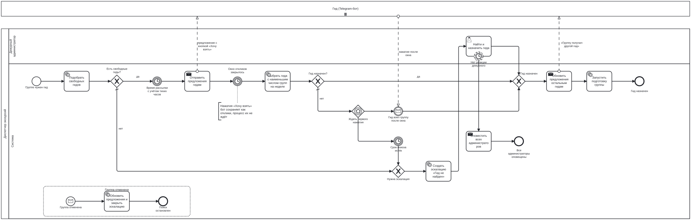
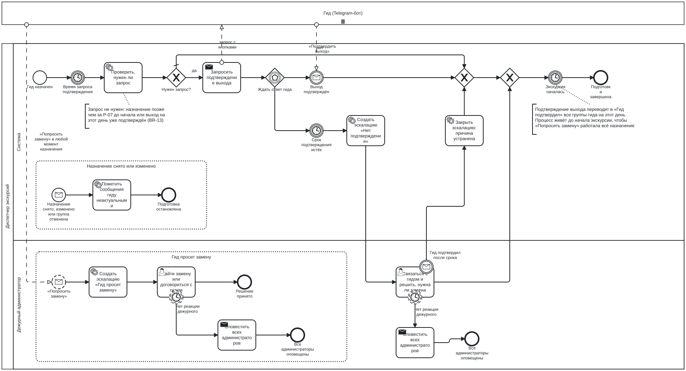
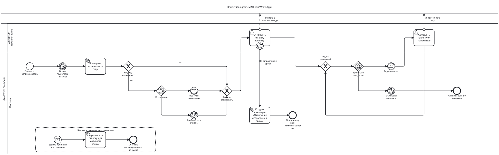
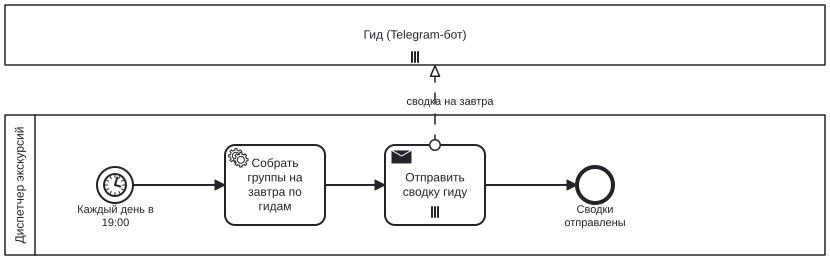

# Процессы

Файлы `.bpmn` открываются в [Camunda Modeler](https://camunda.com/download/modeler/). SVG рядом с исходниками экспортированы из Модлера.

| Файл | Что показывает |
|---|---|
| `as-is-dispatch.bpmn` | Как группа доходит до гида сейчас. Три участника, всё общение между ними — сообщения. Аннотации отмечают боли П1–П4 и Н1 из [AS-IS](../research/as-is.md) |
| `to-be-guide-search.bpmn` | Один раунд поиска гида для группы: рассылка свободным гидам с учётом тихих часов, окно откликов и честный выбор (D-11), первое нажатие после пустого окна, эскалация по сроку, назначение или передача партнёру, отмена в любой момент |
| `to-be-preparation.bpmn` | Подготовка назначенной группы от назначения до начала экскурсии: запрос подтверждения выхода, если он нужен (BR-13), эскалация, если гид молчит, закрытие эскалации при позднем подтверждении, «Попросить замену» в любой момент назначения |
| `to-be-client-notice.bpmn` | Отписка клиенту: ждём назначения гидов, администратор отправляет текст в мессенджер клиента, к сроку не отправлено — эскалация всем администраторам; до начала экскурсии сообщаем клиенту о смене гида |
| `to-be-daily-digest.bpmn` | Сводка на завтра каждый вечер всем гидам с группами |

## Схемы

### AS-IS

### Поиск гида

Отклики «Хочу взять» бот сохраняет в базу, процесс их не ждёт по одному: по таймеру окна задача `select-guide` выполняет выбор по правилам [модели данных](../design/data-model.md). Экземпляр процесса — один раунд поиска: возврат группы в поиск запускает новый.

### Подготовка группы

### Отписка клиенту

### Сводка на завтра

## Исполнимость

В MVP схемы исполняет не Camunda, а планировщик в базе: каждому таймеру, сообщению и типу задачи соответствует задание или обработчик с тем же именем. Какие свойства Camunda планировщик обязан воспроизвести — в [ADR-003](../decisions/adr/ADR-003-scheduler-not-camunda.md). Схемы при этом остаются готовыми к развёртыванию в Camunda 8.

TO-BE подготовлены под Camunda 8.8 и проходят bpmnlint с правилами `camunda-cloud-8-8` без замечаний: у сервисных задач есть типы для воркеров, у сообщений — ключи корреляции, таймеры заданы через FEEL. Проверку запускает CI на каждый PR (`tools/bpmn-lint.mjs`). AS-IS — описательная модель, процессы в ней не исполняемые, для неё — только базовые правила bpmnlint.

Каждый процесс живёт в своём файле: у поиска гида, подготовки, отписки и сводки разный жизненный цикл и разный ключ экземпляра.

## Переменные процессов

| Процесс | Переменная | Откуда | Правило |
|---|---|---|---|
| guide-search | `groupId`, `round` | при запуске | BR-06 |
| guide-search | `candidates` | воркер `find-free-guides` | BR-05 |
| guide-search | `offerAt` | воркер `find-free-guides` | BR-14 |
| guide-search | `windowEndsAt` | воркер `send-offers`: отправка последнего предложения плюс P-21 или P-22 | BR-06, NFR-01 |
| guide-search | `assigned` | воркер `select-guide` | BR-06 |
| guide-search | `searchDeadline` | при запуске | BR-08 |
| guide-search | `dutyAckTimeout` | параметры | P-16 |
| group-preparation | `assignmentId`, `startAt` | при запуске | — |
| group-preparation | `confirmRequestAt` | при запуске: начало минус P-07, а если это тихие часы — 07:00 | BR-13 |
| group-preparation | `confirmDeadlineAt` | при запуске: начало минус P-08, но не раньше запроса плюс P-25 | BR-13 |
| group-preparation | `needsConfirmation` | воркер `check-confirmation-needed`: нет, если назначение позднее или выход на этот день уже подтверждён | BR-13 |
| client-notice | `bookingId`, `startAt` | при запуске | — |
| client-notice | `noticeAt` | при запуске: P-10 накануне | BR-15 |
| client-notice | `noticeDeadline` | при запуске: P-11 накануне, а для заявки, созданной позже, — начало минус P-26 | BR-16 |
| client-notice | `allGuidesAssigned` | воркер `check-guides-assigned` | BR-15 |

Таймеры с датой в прошлом срабатывают сразу. Правила, где это дало бы ложную тревогу, сформулированы так, чтобы такой даты не было: позднее назначение уже подтверждено, у заявки день в день свой крайний срок.

## Договорённости для воркеров

- Отклик из «Свободных групп» до рассылки учитывается в окне вместе с остальными (BR-06).
- Если администратор назначил гида вручную, пока окно открыто, `select-guide` ничего не выбирает и возвращает `assigned = true`: группа уже назначена.
- Пока открыта задача «Назначить гида или передать группу партнёру», назначение из бота или панели закрывает её автоматически (BR-26). Без открытой задачи назначение публикует сообщение `guide-assigned`. Передача партнёру и отмена публикуют `group-closed`, он останавливает поиск.
- Таймер «Нет реакции дежурного» срабатывает через P-16 после создания задачи. Воркер `notify-all-admins` оповещает всех, только если задачу ещё никто не взял.
- Сообщение `all-guides-assigned` публикуется с TTL P-16: если последнего гида назначили между проверкой и началом ожидания, процесс его не пропустит. В планировщике это же свойство обязательно (ADR-003).
- Сообщение `guide-changed` публикуется, только если отписка по заявке уже отправлена: при замене гида и при передаче группы партнёру. До отправки текст собирается из актуальных данных при каждом открытии задачи.
- Отметка «Отправлено» закрывает эскалацию «Отписка не отправлена к сроку» (BR-26).
- Подготовка группы живёт до начала экскурсии: на всё это время открыт подпроцесс «Гид просит замену» (BR-23). Подтверждение выхода после срока прерывает задачу дежурного и закрывает эскалацию.
- Подтверждение выхода переводит в «Гид подтвердил» все группы гида на этот день, поэтому `check-confirmation-needed` у его следующих групп вернёт `false`.
- При переносе времени текущий экземпляр `group-preparation` останавливается сообщением `assignment-ended`. Новый запускается, когда гид подтвердит новое время (BR-21).
- Время сводки задано cron в таймере `daily-digest`: `0 0 16 * * *` — это 19:00 по Москве, потому что cron в Camunda 8 считается в UTC. Меняется переразвёртыванием, в MVP — релизом расписания задания ([NFR-14](../requirements/nfr.md)).

## Что обновить после правки схем

SVG рядом с исходниками экспортируются из Camunda Modeler: открыть `.bpmn`, проверить раскладку, File → Export As Image → SVG, заменить файл рядом. В v0.4 изменены `to-be-preparation`, `to-be-client-notice` и `to-be-guide-search`.
