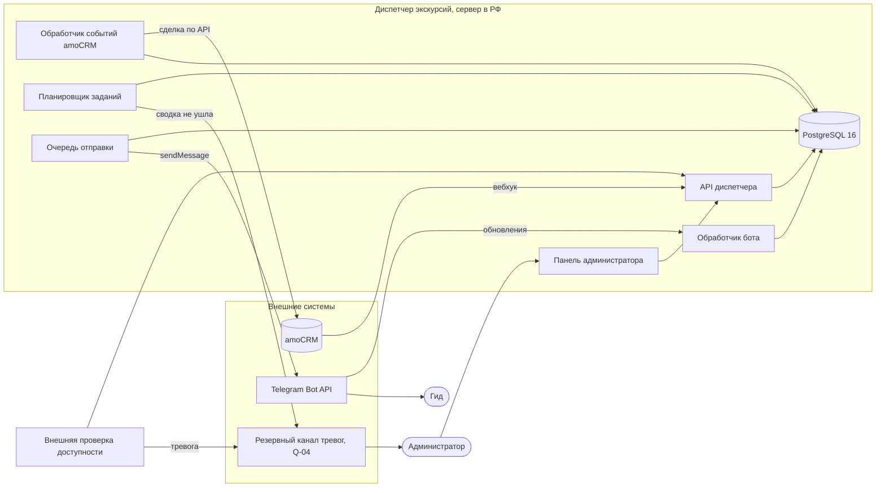

# Архитектура

Версия 0.4. Уровень контейнеров по C4: из чего состоит диспетчер и с кем он говорит. Решения — в [ADR](../decisions/adr), контракты — в [OpenAPI](../api/openapi.yaml) и [интеграциях](../integrations).

| Контейнер | Что делает | Требования |
|---|---|---|
| Панель администратора | Доска групп, ручное назначение, эскалации, отписки, параметры, дежурства | US-06, US-10, US-16, US-17 |
| API диспетчера | Контракт панели и приём вебхуков: ключ идемпотентности, версии, каталог ошибок | [OpenAPI](../api/openapi.yaml), NFR-09 |
| Обработчик бота | Нажатия кнопок и сообщения гидов, дедупликация по `update_id`, раунды поиска | US-04, US-09, [Telegram](../integrations/telegram.md) |
| Обработчик событий amoCRM | Сохранённый вебхук → сделка из API → заявка и группы; сверка с момента последней успешной | [ADR-001](../decisions/adr/ADR-001-webhook-as-signal.md), NFR-04, NFR-06 |
| Планировщик заданий | Таймеры и ожидания процессов BPMN: окна, сводка, подтверждения, сроки эскалаций | [ADR-003](../decisions/adr/ADR-003-scheduler-not-camunda.md), NFR-02, NFR-03 |
| Очередь отправки | Сообщения в Telegram с ограничением скорости, ретраями и сроком годности | NFR-01, NFR-08 |
| PostgreSQL 16 | Данные и правила, которые гарантирует база: пересечения, статусы, журнал | [модель данных](data-model.md), NFR-11 |
| Внешняя проверка и резервный канал | Тревога администраторам, если диспетчер или Telegram молчат | NFR-07, NFR-16, D-14 |

## Развёртывание, предложение

Одна виртуальная машина в РФ с API, ботом, планировщиком и очередью и управляемый PostgreSQL у того же провайдера. Резервная копия базы — раз в сутки, хранение 14 дней, проверка восстановления раз в месяц. Значения — предложение, их и владельца эксплуатации согласуем с заказчиком (Q-01 в [видении](../requirements/vision.md#эксплуатация-и-владелец)).

## Макет доски администратора

Макет к US-17 и US-28: группы дня по времени, статус, гид, подтверждение выхода, отписка, эскалации и фильтр «Требуют внимания». Данные вымышленные.
