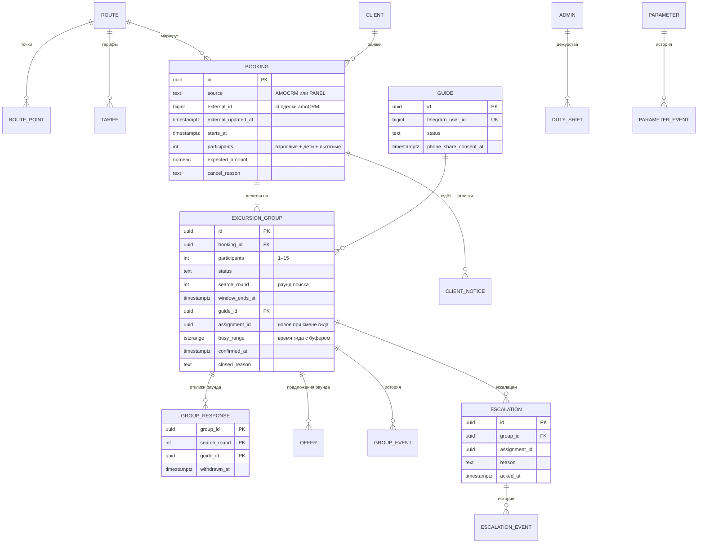

# Модель данных

Версия 0.4. DDL — [`ddl.sql`](ddl.sql), PostgreSQL 16, схема `dispatch`. Правила, которые можно гарантировать в базе, гарантируются в базе. Это проверяет [`ddl-checks.sql`](ddl-checks.sql), а в репозитории — CI на каждый PR.

## Как проверить

```bash
createdb ed_check
psql -v ON_ERROR_STOP=1 -d ed_check -f ddl.sql -f ddl-checks.sql   # 32 проверки, «Все проверки пройдены»
```

## Схема



Справочники маршрутов, тарифов и точек ведёт служба. Заявки приходят из amoCRM или создаются в панели. Группы, отклики, предложения, отписки, эскалации и история принадлежат диспетчеру.

## Правило → механизм → проверка

| Правило | Механизм в базе | Чем проверено |
|---|---|---|
| BR-02 Деление поровну | Функция `split_participants`: ⌈N / 15⌉ групп, размеры отличаются не больше чем на 1 | ddl-checks |
| BR-07, BR-09 У гида нет пересекающихся групп | `EXCLUDE USING gist (guide_id WITH =, busy_range WITH &&)`; CHECK запрещает пустой диапазон, иначе он обходил бы ограничение. Исключений для ручного назначения нет (D-13) | ddl-checks |
| BR-06, D-11 Отклик и первое нажатие | Функция `respond`: откликнуться может любой активный гид без пересечения, до рассылки и в окне — отклик, после пустого окна — назначение; нажатие сразу после окна сначала разыгрывает окно | ddl-checks |
| BR-06, D-11 Честный выбор по окну | Функция `select_guide`: кандидаты текущего раунда по числу групп на неделе, при равенстве случайно; кандидат с пересечением отсеивается ограничением; буфер берётся из P-02 | ddl-checks |
| Повторный поиск | `search_round` растёт при каждом возврате в SEARCHING; ключи откликов и предложений включают раунд | ddl-checks |
| Повторное нажатие, отзыв и новый отклик | Первичный ключ (`group_id`, `search_round`, `guide_id`); повторный отклик снимает отметку отзыва | ddl-checks |
| Статусная модель, NFR-11 | Таблица `group_transition`, триггеры `guard_group` и `log_group`; автор и причина — из `SET LOCAL dispatch.actor` и `dispatch.reason` | ddl-checks |
| Подтверждение принадлежит назначению | Триггер `guard_group`: смена гида даёт новый `assignment_id` и снимает подтверждение прежнего | ddl-checks |
| BR-35 Передача партнёру, главная метрика | Статус HANDED_OVER только из SEARCHING, с причиной PARTNER и именем партнёра | ddl-checks |
| BR-27 Одна открытая эскалация на причину | Частичный уникальный индекс по назначению (или группе, или заявке) и причине для незакрытых | ddl-checks |
| BR-25, NFR-11 История эскалаций | `acked_by` и `acked_at` вместе, таблица `escalation_event` и триггер | ddl-checks |
| US-08 Сводка не уходит дважды | UNIQUE `notification.dedup_key`: `digest:<гид>:<дата>` | ddl-checks |
| NFR-08 Срок годности и предел попыток | `notification.expires_at`, `attempts` от 0 до 5 | ddl-checks |
| NFR-04 Старое событие amoCRM не перетирает новое | `apply_crm_booking`: старше — STALE, то же время и те же данные — UNCHANGED, то же время с другими данными — применяем | ddl-checks |
| BR-32 Тариф на дату | Исключающее ограничение по периодам действия; `expected_amount` возвращает NULL, если для категории нет тарифа | ddl-checks |
| BR-04 Аварийная отмена | `crm_resync_required` только у заявок из amoCRM | ddl-checks |
| Причины отмены и отказа | `booking.cancel_reason` обязателен для CANCELLED; причина отказа гида — в `group_event.reason` | ddl-checks |
| US-25 Один дежурный | Исключающее ограничение по интервалам дежурств | ddl-checks |
| BR-28 Приглашение по deep link | CHECK на формат токена: Telegram передаёт в `start` до 64 символов A–Z, a–z, 0–9, `_` и `-` | ddl-checks |
| BR-15, BR-16 Отписка | Частичный уникальный индекс: одна открытая отписка на заявку и вид; `sent_text` обязателен для SENT | ddl-checks |
| BR-17, BR-28 Согласие гида | CHECK: активный гид без согласия на передачу телефона невозможен | ревью |
| NFR-10 Обезличивание клиента | CHECK: обезличенный клиент без телефона и без имени | ddl-checks |
| NFR-14 Параметры | Значения по умолчанию в `parameter`, история в `parameter_event` | ddl-checks |

## Решения по данным

- **Буфер P-02 хранится в назначении, а не в ограничении.** `busy_range` считается при назначении по текущему значению параметра: `select_guide` и `respond` читают P-02 из таблицы параметров. Служба меняет буфер без миграции, новые назначения его учитывают.
- **P-01 — жёсткий предел в базе.** Максимум 15 человек на гида — практика службы, а CHECK страхует от ошибки в коде. Поменять его можно только миграцией, это исключение из NFR-14.
- **Раунд поиска вместо очистки откликов.** Отклики прошлых раундов не удаляются: по ним видно, кто откликался и почему группа ушла другому. Действуют только отклики текущего раунда.
- **Подтверждение — свойство назначения.** Замена гида не может унаследовать «Гид подтвердил»: доска не должна показывать подтверждение человека, который ничего не подтверждал.
- **Текст отписки не хранится до отправки.** Его собирают из актуальных данных при каждом показе администратору, поэтому смена гида или места сбора до отправки попадает в текст сама. В момент «Отправлено» фиксируется то, что ушло клиенту.
- **У вебхуков amoCRM нет идентификатора события.** Ключ дедупликации собирается из id сделки, действия и `last_modified`: `amocrm:lead:<id>:<action>:<last_modified>`. Тело вебхука стирается через P-27 после обработки.
- **События одной сделки обрабатываются строго по очереди.** Иначе два ответа API в одну секунду нельзя упорядочить: `updated_at` в amoCRM — целые секунды.
- **Неделя для выбора гида — неделя самой группы**, а не текущая: так выбор воспроизводим и не зависит от того, когда закрылось окно.
- **История не удаляется**, отменённые и переданные группы остаются с причиной.
