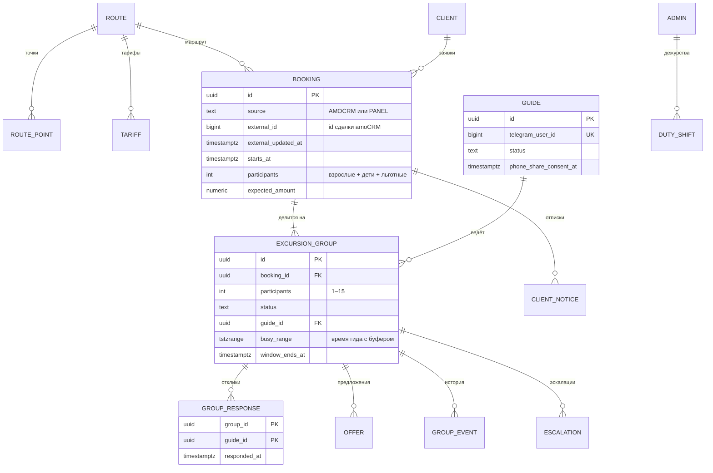

# Модель данных

Версия 0.3. DDL — [`ddl.sql`](ddl.sql), PostgreSQL 16, схема `dispatch`. Правила, которые можно гарантировать в базе, гарантируются в базе. Это проверяет [`ddl-checks.sql`](ddl-checks.sql).

## Как проверить

```bash
createdb ed_check
psql -v ON_ERROR_STOP=1 -d ed_check -f ddl.sql -f ddl-checks.sql   # 13 проверок, «Все проверки пройдены»
```

## Схема



Справочники маршрутов, тарифов и точек ведёт служба. Заявки приходят из amoCRM или создаются в панели. Группы, отклики, предложения, отписки, эскалации и история принадлежат диспетчеру.

## Правило → механизм → проверка

| Правило | Механизм в базе | Чем проверено |
|---|---|---|
| BR-02 Деление поровну | Функция `split_participants`: ⌈N / 15⌉ групп, размеры отличаются не больше чем на 1 | ddl-checks |
| BR-07 У гида нет пересекающихся групп | Исключающее ограничение `EXCLUDE USING gist (guide_id WITH =, busy_range WITH &&)`. Буфер P-02 входит в `busy_range` при назначении, поэтому параметр меняется без миграции | ddl-checks |
| BR-06, D-11 Честный выбор по окну | Функция `select_guide`: кандидаты по числу групп на неделе, при равенстве случайно; кандидат с пересечением отсеивается ограничением, берётся следующий; уже назначенная группа не разыгрывается | ddl-checks |
| Повторное нажатие | Первичный ключ (`group_id`, `guide_id`) у откликов | ddl-checks |
| Статусная модель, NFR-11 | Таблица `group_transition`, триггеры `guard_group` и `log_group`; автор изменения — из `SET LOCAL dispatch.actor` | ddl-checks |
| BR-27 Одна открытая эскалация на причину | Частичный уникальный индекс по группе и причине для незакрытых | ddl-checks |
| US-08 Сводка не уходит дважды | UNIQUE `notification.dedup_key`: `digest:<гид>:<дата>` | ddl-checks |
| NFR-04 Старое событие amoCRM не перетирает новое | `apply_crm_booking` сравнивает `updated_at` сделки с сохранённым | ddl-checks |
| BR-32 Тариф на дату | Исключающее ограничение по периодам действия; функция `expected_amount` | ddl-checks |
| US-25 Один дежурный | Исключающее ограничение по интервалам дежурств | ddl-checks |
| BR-28 Приглашение по deep link | CHECK на формат токена: Telegram передаёт в `start` до 64 символов A–Z, a–z, 0–9, `_` и `-` | ddl-checks |
| BR-15 Одна открытая отписка на заявку | Частичный уникальный индекс по заявке и виду отписки | ревью |
| BR-17, BR-28 Согласие гида | CHECK: активный гид без согласия на передачу телефона невозможен | ревью |
| NFR-10 Обезличивание клиента | CHECK: телефон пуст тогда и только тогда, когда клиент обезличен | ревью |

## Решения по данным

- **Буфер P-02 хранится в назначении, а не в ограничении.** `busy_range` считается при назначении по текущему значению параметра. Служба меняет буфер без миграции, новые назначения его учитывают.
- **P-01 — жёсткий предел в базе.** Максимум 15 человек на гида — практика службы, а CHECK страхует от ошибки в коде. Поменять его можно только миграцией, это исключение из NFR-14.
- **У вебхуков amoCRM нет идентификатора события.** Ключ дедупликации собирается из id сделки, действия и `last_modified`: `amocrm:lead:<id>:<action>:<last_modified>`.
- **Неделя для выбора гида — неделя самой группы**, а не текущая: так выбор воспроизводим и не зависит от того, когда закрылось окно.
- **История не удаляется**, отменённые группы остаются с причиной.
