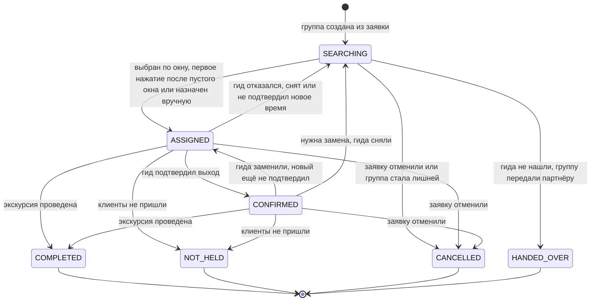

# Статусная модель группы

Версия 0.4. Переходы зашиты в базу: таблица `group_transition` и триггер `guard_group` в [`ddl.sql`](ddl.sql), запрещённый переход — ошибка, каждое изменение пишется в историю (NFR-11).

| Статус | Что значит | На доске администратора | Гид назначен |
|---|---|---|---|
| SEARCHING | Ищем гида: до рассылки, в окне откликов или ждём первого нажатия | Ищем гида | нет |
| ASSIGNED | Гид назначен, выход ещё не подтверждён | Гид назначен | да |
| CONFIRMED | Гид подтвердил выход (BR-13) | Гид подтвердил | да |
| COMPLETED | Экскурсия проведена | Проведена | да |
| NOT_HELD | Клиенты не пришли | Не состоялась | да |
| CANCELLED | Отменена: заявку отменили или группа стала лишней | Отменена | нет |
| HANDED_OVER | Гида не нашли, группу ведёт партнёр (BR-35) | Передана партнёру | нет |

## Инварианты

- У группы в статусах ASSIGNED, CONFIRMED, COMPLETED и NOT_HELD есть гид, в остальных — нет.
- У гида нет двух групп, которые пересекаются по времени с учётом буфера P-02. Это исключающее ограничение базы, исключений нет, в том числе для ручного назначения (D-13).
- Каждая смена гида — новое назначение со своим `assignment_id`. Подтверждение выхода принадлежит назначению: при замене гида подтверждённая группа возвращается в ASSIGNED. Исключение — позднее назначение, которое по BR-13 само считается подтверждением.
- Каждый возврат в SEARCHING открывает новый раунд поиска. Предложения и отклики прошлого раунда в нём не действуют.
- У CANCELLED и HANDED_OVER есть причина закрытия, у HANDED_OVER — ещё и партнёр.
- Из COMPLETED, NOT_HELD, CANCELLED и HANDED_OVER переходов нет.
- Каждое изменение статуса или гида — строка в `group_event`: кто, когда, что было и что стало, почему.

## Кто переводит группу в COMPLETED

В MVP — система: этап сделки «Проведена» в amoCRM переводит заявку в COMPLETED, а её назначенные группы — в COMPLETED. Если этап не поменяли, через P-18 после окончания экскурсии группа переходит в COMPLETED сама, а администратор видит её в «Требует внимания». Кнопка гида «Завершить экскурсию» (US-19) — история Could.
