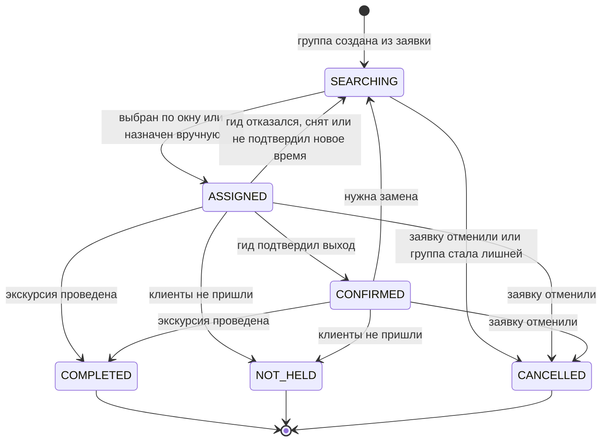

# Статусная модель группы

Версия 0.3. Переходы зашиты в базу: таблица `group_transition` и триггер `guard_group` в [`ddl.sql`](ddl.sql), запрещённый переход — ошибка, каждое изменение пишется в историю (NFR-11).

| Статус | Что значит | На доске администратора | Гид назначен |
|---|---|---|---|
| SEARCHING | Ищем гида: идёт окно откликов или ждём первого нажатия | Ищем гида | нет |
| ASSIGNED | Гид назначен, выход ещё не подтверждён | Гид назначен | да |
| CONFIRMED | Гид подтвердил выход за 2 ч до начала | Гид подтвердил | да |
| COMPLETED | Экскурсия проведена | Проведена | да |
| NOT_HELD | Клиенты не пришли | Не состоялась | да |
| CANCELLED | Отменена | Отменена | нет |

## Инварианты

- У группы в статусах ASSIGNED, CONFIRMED, COMPLETED и NOT_HELD есть гид, в остальных — нет.
- У гида нет двух групп, которые пересекаются по времени с учётом буфера P-02: это исключающее ограничение базы, а не проверка в коде.
- Из COMPLETED, NOT_HELD и CANCELLED переходов нет.
- Каждое изменение статуса или гида — строка в `group_event`: кто, когда, что было и что стало.
