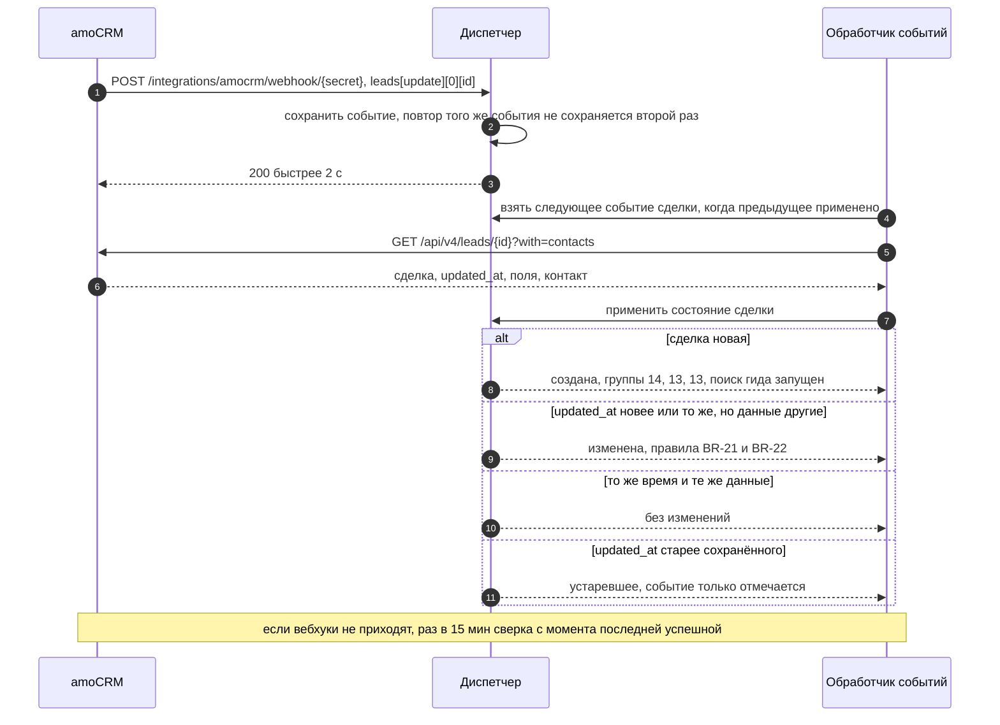
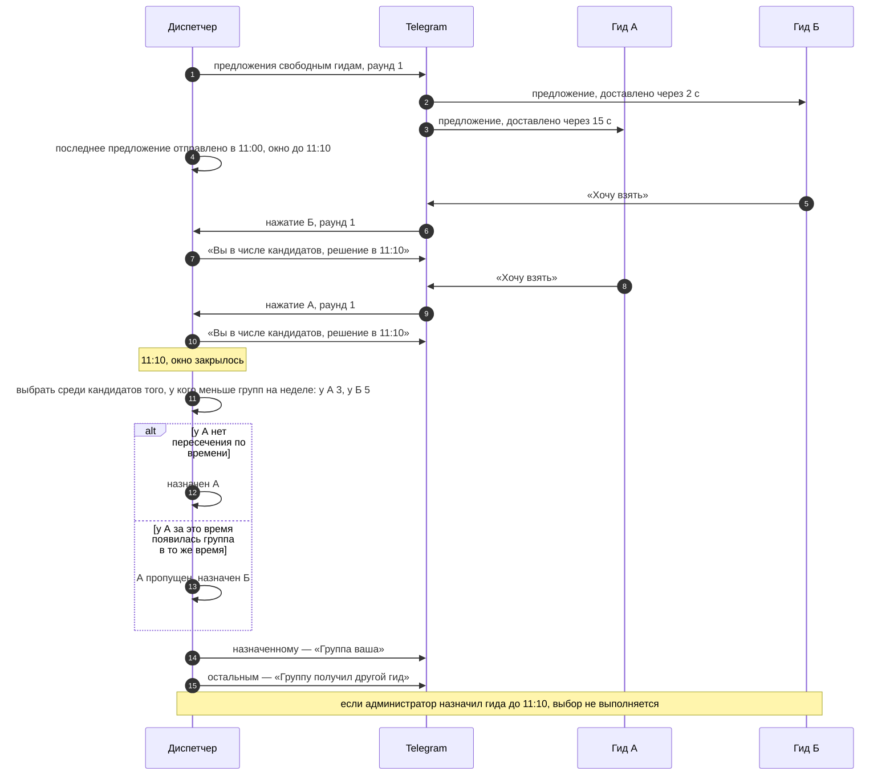
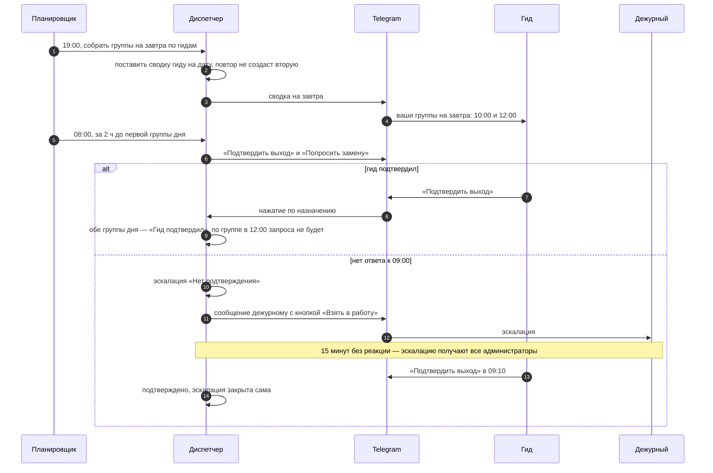
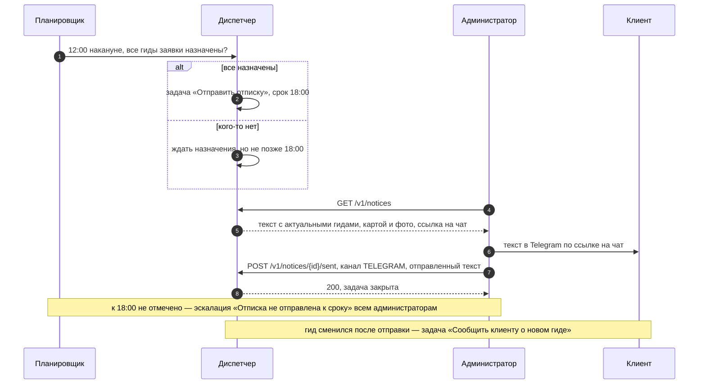
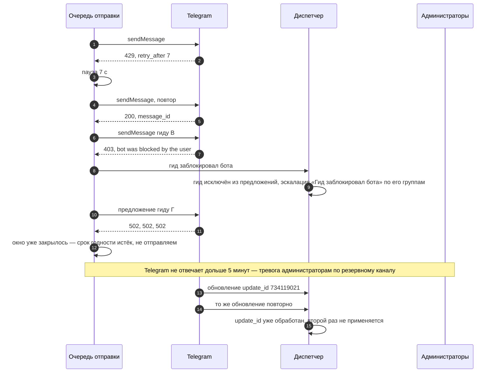
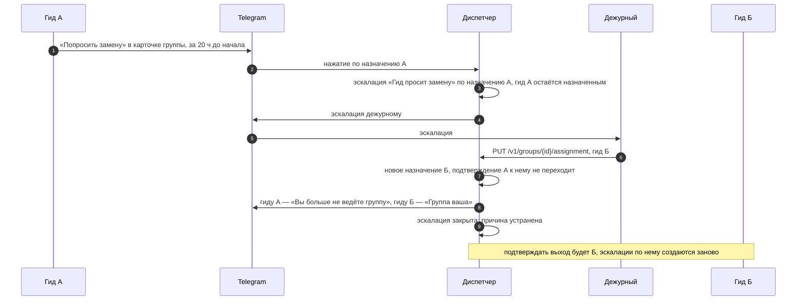

# Sequence-диаграммы

Версия 0.4. Вызовы и коды совпадают с [OpenAPI](../api/openapi.yaml), интеграции — с [amoCRM](../integrations/amocrm.md) и [Telegram](../integrations/telegram.md), гарантии — с [моделью данных](data-model.md). На диаграммах — операции и бизнес-результаты, а не функции и ограничения базы: если выбор гида переедет из базы в код, диаграммы останутся правдой.

| Диаграмма | Что разбирает |
|---|---|
| [SD-1. Заявка из amoCRM](#sd-1-заявка-из-amocrm) | Вебхук как сигнал, дубли, устаревшие события, правки в одну секунду |
| [SD-2. Окно откликов и честный выбор](#sd-2-окно-откликов-и-честный-выбор) | D-11, пересечения, ручное назначение во время окна |
| [SD-3. Сводка и подтверждение выхода](#sd-3-сводка-и-подтверждение-выхода) | US-08, US-09, эскалация «Нет подтверждения» |
| [SD-4. Отписка клиенту](#sd-4-отписка-клиенту) | US-10, крайний срок, смена гида до и после отписки |
| [SD-5. Сбои Telegram](#sd-5-сбои-telegram) | 429, 5xx, 403, срок годности, повтор обновления |
| [SD-6. Поздний отказ и замена](#sd-6-поздний-отказ-и-замена) | US-14, «Попросить замену» в любой момент, новое назначение |

## SD-1. Заявка из amoCRM

amoCRM ждёт ответ не дольше 2 секунд, поэтому вебхук только сохраняется. Данные сделки берутся из API: вебхук — сигнал, а не источник правды ([ADR-001](../decisions/adr/ADR-001-webhook-as-signal.md)).

## SD-2. Окно откликов и честный выбор

Скорость доставки уведомлений Telegram у гидов разная, поэтому порядок нажатий в окне не важен, а само окно отсчитывается от последнего отправленного предложения ([ADR-002](../decisions/adr/ADR-002-response-window.md)).

## SD-3. Сводка и подтверждение выхода

Подтверждение — одно на день гида, перед первой группой (BR-13, D-15).

## SD-4. Отписка клиенту

Текст отписки собирается при каждом открытии задачи, а фиксируется в момент «Отправлено» (BR-15, BR-16).

## SD-5. Сбои Telegram

## SD-6. Поздний отказ и замена

«Попросить замену» работает всё время назначения, а не только в ответ на запрос подтверждения (BR-23).

