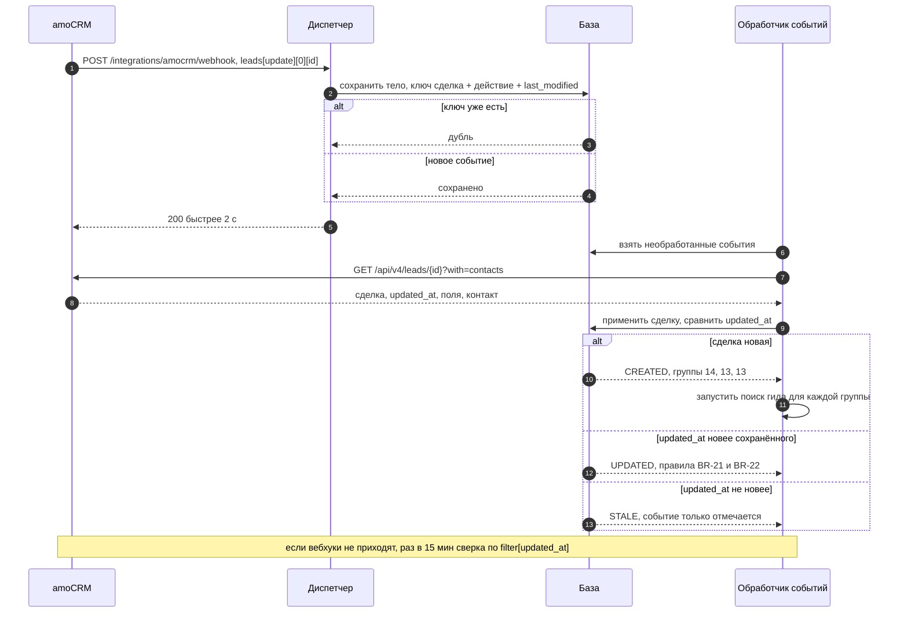
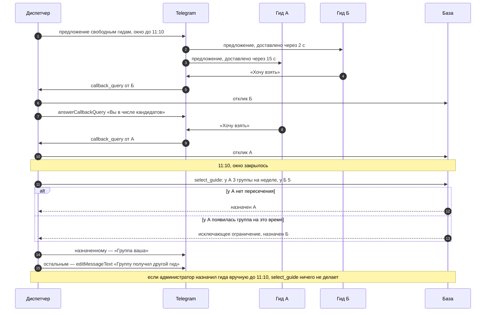
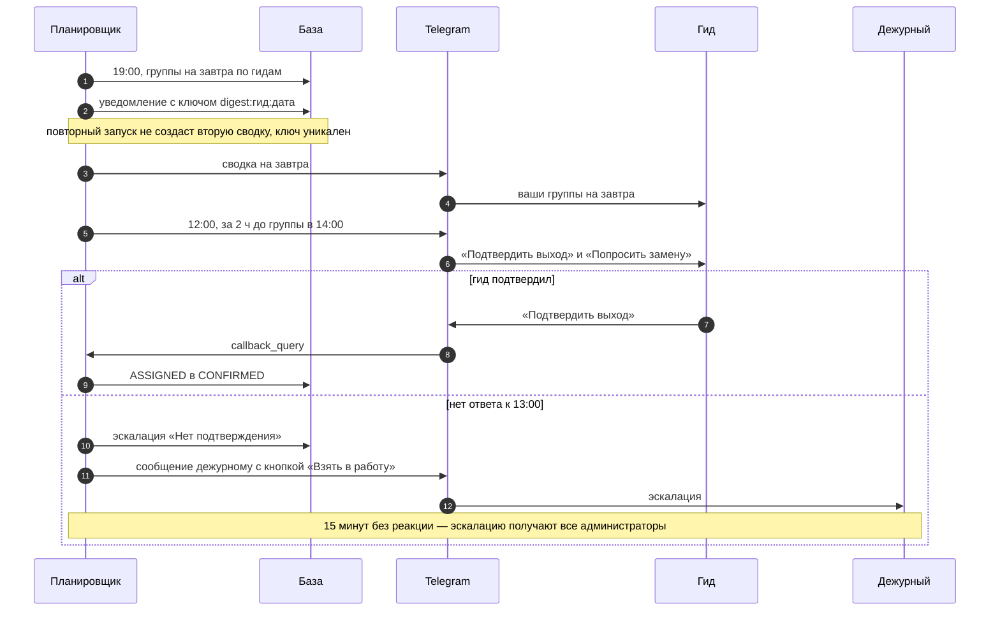
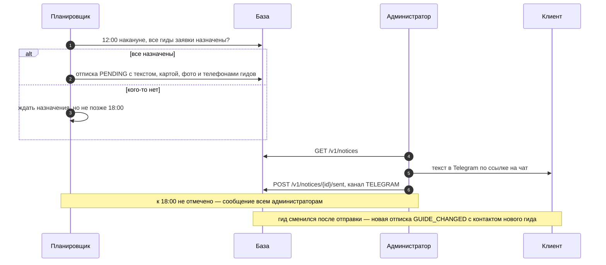
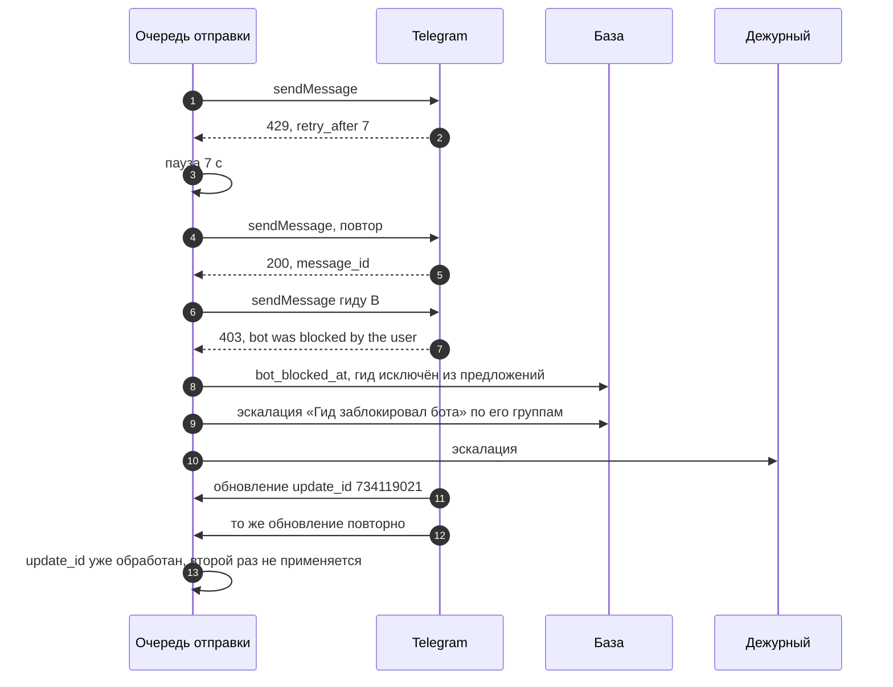

# Sequence-диаграммы

Версия 0.3. Вызовы и коды совпадают с [OpenAPI](../api/openapi.yaml), интеграции — с [amoCRM](../integrations/amocrm.md) и [Telegram](../integrations/telegram.md), правила базы — с [моделью данных](data-model.md).

| Диаграмма | Что разбирает |
|---|---|
| [SD-1. Заявка из amoCRM](#sd-1-заявка-из-amocrm) | Вебхук как сигнал, дубли, устаревшие события |
| [SD-2. Окно откликов и честный выбор](#sd-2-окно-откликов-и-честный-выбор) | D-11, пересечения, ручное назначение во время окна |
| [SD-3. Сводка и подтверждение выхода](#sd-3-сводка-и-подтверждение-выхода) | US-08, US-09, эскалация «Нет подтверждения» |
| [SD-4. Отписка клиенту](#sd-4-отписка-клиенту) | US-10, крайний срок, смена гида после отписки |
| [SD-5. Сбои Telegram](#sd-5-сбои-telegram) | 429, 403, повтор обновления |

## SD-1. Заявка из amoCRM

amoCRM ждёт ответ не дольше 2 секунд, поэтому вебхук только сохраняется. Данные сделки берутся из API: вебхук — сигнал, а не источник правды ([ADR-001](../decisions/adr/ADR-001-webhook-as-signal.md)).

## SD-2. Окно откликов и честный выбор

Скорость доставки уведомлений Telegram у гидов разная, поэтому порядок нажатий в окне не важен ([ADR-002](../decisions/adr/ADR-002-response-window.md)).

## SD-3. Сводка и подтверждение выхода

## SD-4. Отписка клиенту

## SD-5. Сбои Telegram

