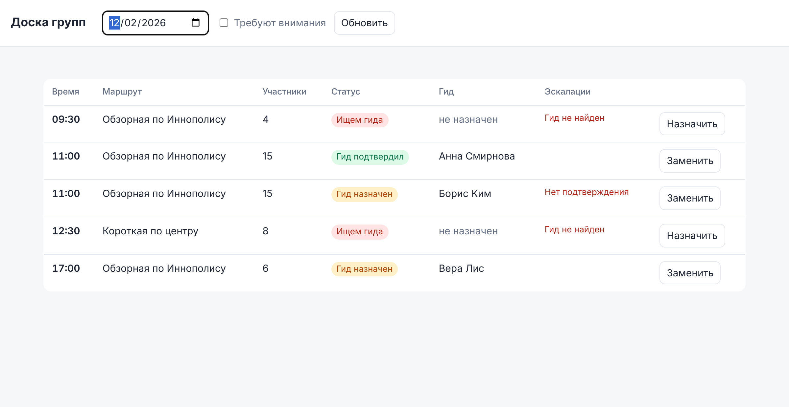

# Итерация 3: MVP релиза 1

Версия 0.6. В итерации 3 спецификация стала работающим сервисом. Диспетчер релиза 1 написан на модели данных и контрактах итераций 1–2 без отступлений от них, а там, где спецификация не давала ответа, она исправлена или вопрос вынесен на решение. Код и запуск — [app](../../app/README.md).

## Что сделано

| Что | Где | Сколько |
|---|---|---|
| Сервис: API панели, бот, приём событий amoCRM, планировщик, очередь отправки | [`app/src`](../../app/src) | 9 историй релиза 1 |
| Доска групп для администратора | [`app/public/board.html`](../../app/public/board.html) | US-17, назначение с доски |
| Приёмочные тесты по сценариям бэклога | [`app/test`](../../app/test) | 70 тестов, 40 из 40 сценариев релиза 1 |
| Протокол приёмки: сценарий → тест | [acceptance.md](acceptance.md) | собирается из бэклога и тестов, CI проверяет актуальность |
| Проверка каждого ответа API по OpenAPI | [`app/test/contract.mjs`](../../app/test/contract.mjs) | код описан, тело по схеме, лишних полей нет, заголовки на месте |
| CI | [`spec-checks.yml`](../../.github/workflows/spec-checks.yml) | джоб «MVP релиза 1» на PostgreSQL 16 |

Тесты проверяют поведение, нарисованное в BPMN, как требует [ADR-003](../decisions/adr/ADR-003-scheduler-not-camunda.md): проходы планировщика носят имена задач из схем, корреляция идёт по `assignmentId` (подтверждение снятого гида не применяется), таймер с датой в прошлом срабатывает сразу. Отдельно проверены NFR-03 (перезапуск посреди сценария), NFR-05 (два администратора назначают одновременно), NFR-08 (ответы Telegram 429, 5xx, 403, срок годности), NFR-09, NFR-10, NFR-14 и NFR-16.

Чтобы убедиться, что проверка по контракту не пустая, я добавил в ответ группы лишнее поле: упали 8 тестов из 9 в файле назначений.

## Находки

Код пришлось написать так, чтобы он отвечал на каждый запрос, и спецификация показала 15 мест без ответа. Там, где ответ однозначно следует из правил, спецификация исправлена в этом же PR. Остальное — вопросы со статусом и предложением.

| ID | Что | Последствие | Что сделано |
|---|---|---|---|
| M-01 | У таблицы `notification` (outbox) нет тела сообщения | Очередь отправки есть, а отправлять нечего | Колонки `body`, `group_id`, `assignment_id` — в схеме приложения. Перенести в модель данных |
| M-02 | В статусной модели нет перехода `SEARCHING → CONFIRMED`, а BR-13 требует, чтобы позднее назначение сразу было подтверждением | База отвергала назначение гида на группу без гида меньше чем за 2 ч до начала — самый срочный случай | **Исправлено в спецификации:** переход в [`ddl.sql`](../design/ddl.sql) и [статусной модели](../design/group-states.md), проверка в `ddl-checks.sql`. В релизе 2 то же нужно в `respond` |
| M-03 | Раздела «Требует внимания» нет ни в модели, ни в API, хотя на него ссылаются US-01, BR-04, BR-32, BR-36. У части пунктов нет даже заявки: сделку без полей не сохранить | Администратор не узнает о заявке, которую диспетчер не принял | **Исправлено:** таблица `attention`, операция `GET /v1/attention` в [OpenAPI](../api/openapi.yaml) |
| M-04 | Назначение требует `If-Match` с версией группы, но ни одна операция эту версию не отдаёт | Панель не может назначить гида по контракту | **Исправлено:** `version` в элементе доски |
| M-05 | У операций с проверкой тела и параметров не было ответа 400: доска, отмена, назначение, снятие, эскалации, гиды | Ошибка в данных — ответ вне контракта | **Исправлено:** 400 `VALIDATION_ERROR` у семи операций |
| M-06 | NFR-09 требует вход по учётной записи и сессию на 12 ч, а в контракте нет ни входа, ни выхода | Панель нельзя защитить по контракту | MVP — токены администраторов из настроек. Вопрос Q-07 в [видении](../requirements/vision.md#эксплуатация-и-владелец), до пилота |
| M-07 | Пример US-09 «группы в 10:00 и 12:00» невозможен на маршруте 2 ч: с буфером P-02 они пересекаются, и BR-07 запрещает назначение | Тест по примеру падал на правильном правиле | Пример верен для маршрута до 1,5 ч, уточнение в [бэклоге](../requirements/backlog.md#us-09-подтверждение-выхода) |
| M-08 | US-11 обещает, что об отмене «на завтра в 23:00» гид узнаёт сразу, а BR-14 снимает тихие часы только для групп в ближайшие 12 ч | Об отмене группы на 15:00 завтра гид узнает в 07:00 | Работает по BR-14, уточнение в [бэклоге](../requirements/backlog.md#us-11-отмена-заявки) |
| M-09 | «Требуют внимания» на доске: что значит «без подтверждения» | Можно понять как «срок прошёл», а можно как «ещё не подтвердил» | Группа в статусе «Гид назначен». Просроченные и так видны по эскалации «Нет подтверждения». Уточнение в [бэклоге](../requirements/backlog.md#us-17-доска-групп) |
| M-10 | В `to-be-guide-search.bpmn` задача называется «Выбрать гида с наименьшим числом групп на неделе», а D-17 заменило правило жребием | Расхождение схемы и правила в релизе 2 | Не исправлено: схема — в релиз 2 вместе с окном откликов |
| M-11 | Подтверждение — одно на день (D-15), а срок подтверждения у каждой группы свой | Непонятно, когда эскалировать вторую группу дня | Запрос — один перед первой группой, «Нет подтверждения» — по каждой группе в её срок, подтверждение закрывает все |
| M-12 | US-07 в релизе 1 требует «Позвонить клиенту» через подменный номер, а провайдер (Q-06) запланирован «до релиза 2». Тревоги NFR-16 звонком — тоже релиз 1 | Пилот нельзя начать без провайдера | MVP — статичный номер и журнал вызовов. Срок Q-06 — до пилота релиза 1 |
| M-13 | BR-22 (изменение числа участников) — история US-13 релиза 2, но сделку в amoCRM меняют и в релизе 1, а сценарий US-01 «две правки в одну секунду» прямо требует вторую группу | Без BR-22 изменение из CRM потерялось бы | BR-22 работает уже в релизе 1, в [видении](../requirements/vision.md#границы-mvp) это отмечено |
| M-14 | Графика дежурств в панели нет до релиза 2 (US-25) | По BR-25 без дежурного эскалация уходит сразу всем | Так и работает; когда дежурство есть в базе — сначала ему, через P-16 всем |
| M-15 | В модели нет состояния, которое нужно сервису: ключи действий, `update_id`, шаги подключения гида, запросы подтверждения и нового времени, сроки поиска, разовые запуски, курсор сверки, журнал тревог | Без них правила не исполнить | Схема приложения [`001-mvp.sql`](../../app/sql/001-mvp.sql). Что из этого — модель данных, а что — реализация, решаем при переходе к релизу 2 |

## Ретро итерации 3

| Что пошло не так | Что поменял в работе |
|---|---|
| Самый дорогой дефект (M-02) жил в спецификации с итерации 2: `ddl-checks` проверяли переходы, которые есть, но не сценарий, который требует нового перехода | Тест пишется по сценарию бэклога, а не по таблице переходов |
| Два первых падения были в тестах: пример US-09 на маршруте 2 ч и параметр, который соседний тест поменял и не вернул | Каждый тест возвращает общие параметры; у файла тестов своя база |
| Проверка по контракту сразу показала, что панель не может сделать главное действие релиза — назначить гида (M-04) | Контракт проверяется не линтером, а живыми ответами сервиса |
