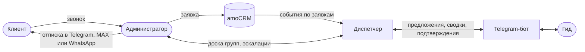

# Видение: Диспетчер экскурсий

Версия 0.4. Базовая линия — оценки по [исследованию](../research/findings.md#базовая-линия), после запуска их заменят данные системы. Метрики v0.3 пересмотрены по [ревью итерации 2](../reviews/2026-10-27-iteration-2/README.md): две из них нельзя было измерить или выполнить.

## Проблема

Группы доходят до гидов через общий Telegram-чат и личные сообщения администраторов. Сообщение о назначении теряется в личной переписке, гиды забывают про группы, а группы достаются тем, у кого быстрее доходят уведомления. Подробно — в [AS-IS](../research/as-is.md).

## Решение

Диспетчер превращает заявку в группы, предлагает их свободным гидам в Telegram-боте, напоминает гиду о группах, накануне готовит администратору отписки для клиентов и зовёт дежурного, когда процесс встал.

Устройство системы — в [архитектуре](../design/architecture.md).

## Пользователи и стейкхолдеры

| Кто | Что получает | Интерфейс |
|---|---|---|
| Гид — основной пользователь MVP | Предложения групп, сводки, напоминания, все детали группы в одном месте | Telegram-бот |
| Администратор | Группы без ручных рассылок, доска групп, эскалации | Веб-панель и уведомления в Telegram |
| Клиент | Отписка накануне с контактом гида | Мессенджер: Telegram, MAX или WhatsApp, отправляет администратор |
| Владелец службы — заказчик | Меньше групп, отданных партнёрам; решения по правилам и эксплуатации | Демо, протоколы встреч |
| Руководитель службы | Видно, сколько групп, кто ведёт, где проблемы | Отчёты — вне MVP |

## Цели и метрики

| Цель | Метрика | Как считаем | Базовая линия | Цель MVP |
|---|---|---|---|---|
| Ни одна группа не уходит партнёрам из-за того, что гида не нашли | Групп «Передана партнёру» в месяц | Статус HANDED_OVER (BR-35) | около 6, по памяти; сверить с amoCRM (Г12) | меньше 2, если Г12 подтвердится |
| Гид находится вовремя | Доля групп, назначенных до срока эскалации BR-08 | История групп | не измеряется | 95% |
| Группы распределяются честно (П6) | Доля групп, доставшихся гидам, которые в момент рассылки вели другую экскурсию; разброс числа групп на гида за неделю | Предложения, отклики, история групп | 10 из 12 гидов считают правило нечестным | доля больше нуля, разброс не растёт; повторный опрос через месяц (Г11) |
| Ни одна группа без гида не остаётся незамеченной | Доля групп, у которых за 24 ч до начала, а для поздних заявок — через P-05 после создания, есть гид или открытая эскалация | История групп и эскалаций | не измеряется | 100% |
| Гид не забывает группу | Забытых групп в месяц | Неявки гида по эскалациям и опрос гидов в боте раз в месяц | 1–2 у 9 из 12 гидов | 0 |
| Администратор не пишет гидам вручную | Минут в день на сообщения гидам, без сбора денег | Неделя самозаписи до запуска и через месяц после ([шаблон](../research/time-log-template.md)) | 120–150, но у одного из трёх администраторов сюда вошёл сбор переводов (F-04) | меньше 15, только эскалации |
| Отписка готовится быстро | Минут на одну отписку | Время от открытия задачи до «Отправлено» | 5–6 | меньше 1 |
| Клиент знает, где сбор и кто гид | Доля заявок, по которым отписка отправлена до срока BR-16 | Отписки | не измеряется | все заявки |
| Клиент находит место сбора сам | Звонков гиду с вопросом «куда идти» | Опрос гидов в боте раз в месяц | около 1 в неделю на гида | вдвое меньше |

Время от создания группы до назначения остаётся контрольным показателем, а не целью: по D-11 оно не меньше окна откликов P-21. Если для групп с откликами оно больше P-21 плюс минута, разбираемся, где задержка ([ADR-002](../decisions/adr/ADR-002-response-window.md)).

## Сделать или настроить

| Вариант | Что закрывает | Чего не хватает |
|---|---|---|
| Оставить чат, добавить правила: шаблон сообщения, закреп, календарь у каждого гида | Немного порядка без затрат | Ручная вечерняя рассылка остаётся, гонка «кто первым» тоже |
| Возможности amoCRM: Salesbot и цифровая воронка | Автоматические сообщения по этапам сделки в подключённые мессенджеры | Гиды — не контакты сделок; окно откликов, «Мои группы» и подтверждение выхода нужно собирать поверх. Оценка по описанию возможностей, проверить с интегратором |
| Готовые сервисы расписания смен и онлайн-записи | Расписание сотрудников | Не сравнивали. Критерии сравнения: бот в Telegram для гидов, интеграция с amoCRM, распределение группы между гидами |
| Свой диспетчер — этот проект | Все цели выше | Разработка и сопровождение (см. «Эксплуатация») |

Решение о разработке принимаем после того, как интегратор оценит вариант с amoCRM. Это вопрос Q-02 к заказчику.

## Бизнес-кейс

Оценка на цифрах исследования. Точные значения подставляем из выгрузки amoCRM и от заказчика.

- **Время администраторов.** 2–2,5 ч каждый вечер — это 60–75 часов в месяц. Стоимость часа даёт заказчик.
- **Группы, отданные партнёрам.** 6 в месяц, умноженные на выручку группы. Для примера: группа из 12 взрослых по тарифу 1 000 ₽ — 12 000 ₽, шесть таких групп — 72 000 ₽ выручки в месяц. Сколько из неё служба теряет при передаче, зависит от условий с партнёрами: это вопрос Q-03.
- **Затраты.** Хостинг в РФ, доработка полей amoCRM интегратором, разработка и сопровождение.

Окупаемость в месяцах = затраты на запуск / (сэкономленные часы × стоимость часа + удержанная выручка − расходы на сопровождение в месяц).

## Границы MVP

MVP идёт двумя релизами ([D-12](../decisions/decision-log.md), предложено). Первый закрывает самые дорогие боли — вечерние сообщения и забытые группы — и проверяется пилотом на пяти гидах. Второй добавляет поиск гида в боте и честный выбор.

**Релиз 1, пилот.** Группы из заявок CRM, ручное назначение и снятие гида в панели, подключение гидов по приглашению, «Мои группы», сводка на завтра, подтверждение выхода, отмена и перенос заявки, доска групп.

**Релиз 2.** Предложения гидам и окно откликов, «Свободные группы», честный выбор, изменение числа участников, отказ гида, эскалации дежурному и передача партнёру, отписки, заявки из панели.

Состав по историям — в [бэклоге](backlog.md#сводка). Пилот: две недели параллельно с чатом, критерии успеха — ноль забытых групп у пилотных гидов и меньше 30 минут вечерних сообщений администратора. После пилота чат закрывается для новых групп, это решение службы.

Вне рамок:
- онлайн-запись и онлайн-оплата для клиентов: Г3 не подтвердилась (D-09);
- отметка оплаты и отчёт по оплатам: Г7 не подтвердилась, истории US-19 и US-20 — Could;
- учёт выплат гидам;
- отзывы клиентов;
- отчёты для руководителя;
- другие города и форматы экскурсий.

## Эксплуатация и владелец

У службы нет своих разработчиков и инфраструктуры ([ADR-003](../decisions/adr/ADR-003-scheduler-not-camunda.md)), а диспетчер — это бот, панель, планировщик и база, которые нужно держать работающими. До релиза 1 закрываем с заказчиком:

| ID | Вопрос | Варианты |
|---|---|---|
| Q-01 | Кто владеет системой и сопровождает её | Подрядчик по договору; интегратор amoCRM; разработчик на part-time |
| Q-02 | Делаем свой диспетчер или настраиваем amoCRM | См. «Сделать или настроить» |
| Q-03 | Что служба теряет на группе, переданной партнёру | Вся выручка; выручка минус комиссия партнёра |
| Q-04 | Резервный канал для тревог, если Telegram недоступен (D-14) | SMS-шлюз; звонок; email |
| Q-05 | Политика отмен BR-18 и передача телефона клиента гиду через Telegram — с юристом | Согласовать; изменить правило |

Ручной режим, если диспетчер не работает: администратор получает тревогу (NFR-16) и рассылает гидам сводку из панели или по старой схеме. Инструкция ручного режима — часть приёмки релиза 1.

## Допущения

| ID | Допущение | Что, если неверно |
|---|---|---|
| A1 | У amoCRM есть вебхуки и REST API — подтверждено (Г6) | Администратор создаёт заявки в панели (US-02) |
| A2 | Гиды пользуются Telegram каждый день — подтверждено (Г5). Но Telegram у гидов работает через VPN | Резервный канал для критичных сообщений (D-14, NFR-16) |
| A3 | Политика отмен — стандартная (BR-18, BR-19) — не проверялась | Меняем значения параметров и текст отписки после согласования (Q-05) |
| A4 | Клиенты читают отписку в мессенджере — частично: клиенты звонят гиду спросить дорогу (Г9) | Добавляем звонок администратора как основной канал для таких клиентов |
| A5 | Все экскурсии в одном городе, часовой пояс один | — |
| A6 | Интегратор добавит в сделку поля «Взрослые», «Дети», «Льготные» и «Мессенджер» | До доработки работает переходное правило из [маппинга](../integrations/amocrm.md#маппинг-сделки) |
| A7 | Гиды примут правило «меньше групп на неделе» (Г11) | Запасные варианты: жребий среди откликнувшихся или очередь |

## Ограничения

- Персональные данные клиентов и гидов обрабатываются по 152-ФЗ: минимальный набор, хранение в РФ, доступ по ролям, обезличивание ([NFR-10](nfr.md)). Передача имени и телефона клиента гиду через Telegram — вопрос трансграничной передачи, он вынесен в Q-05.
- Telegram Bot API ограничивает частоту сообщений: рассылки идут через очередь.
- Учебный проект: MVP без мобильного приложения.

## Риски

| Риск | Последствие | Что делаем |
|---|---|---|
| Администраторы продолжают публиковать группы в старом чате | Две системы правды | После пилота чат закрывается для новых групп, это решение службы |
| Гид заблокировал бота | Не получает предложения и напоминания | Бот замечает блокировку, по группам гида создаётся эскалация (BR-31) |
| CRM недоступна или пропустила событие | Заявка не превратилась в группы или правка потерялась | Сверка с момента последней успешной (NFR-06), аварийная отмена в панели (BR-04) |
| Telegram недоступен или тормозит через VPN | Гиды и дежурный не получают сообщения | Резервный канал для тревог (D-14, NFR-16), окно откликов вместо гонки (D-11) |
| Диспетчер упал, а все думают, что он работает | Сводка не ушла, группы забыты — хуже, чем сейчас | Контроль «сводка ушла» и тревога по резервному каналу (NFR-16) |
| Интегратор не добавит поля в amoCRM | Ожидаемая сумма и мессенджер клиента неизвестны | Переходное правило маппинга (A6) |
| Гиды не примут правило «меньше групп» | Гиды перестают откликаться | Опрос до релиза 2 (Г11), запасные варианты в A7 |
| Причина шести групп в месяц — нехватка гидов, а не потерянные сообщения | Цель «меньше 2» недостижима | Разбор этих случаев по amoCRM до релиза 2 (Г12) |
| WhatsApp в РФ работает с перебоями | Отписка не доходит | Канал хранится в заявке и меняется; администратор отправляет в другой мессенджер или звонит (BR-16) |
