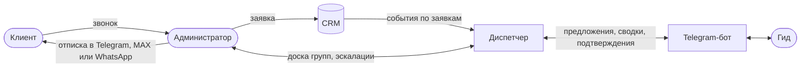

# Видение: Диспетчер экскурсий

Версия 0.2. Базовая линия — оценки по [исследованию](../research/findings.md#базовая-линия), после запуска их заменят данные системы.

## Проблема

Группы доходят до гидов через общий Telegram-чат и личные сообщения администраторов. Сообщения теряются в ленте, гиды забывают про группы, а об изменениях узнают, только если администратор не забыл написать. Подробно — в [AS-IS](../research/as-is.md).

## Решение

Диспетчер превращает заявку в группы, предлагает их свободным гидам в Telegram-боте, напоминает гиду о группах, накануне готовит администратору отписки для клиентов и зовёт дежурного, когда процесс встал.

## Пользователи и стейкхолдеры

| Кто | Что получает | Интерфейс |
|---|---|---|
| Гид — основной пользователь MVP | Предложения групп, сводки, напоминания, все детали группы в одном месте | Telegram-бот |
| Администратор | Группы без ручных рассылок, доска групп, эскалации | Веб-панель и уведомления в Telegram |
| Клиент | Отписка накануне с контактом гида | Мессенджер: Telegram, MAX или WhatsApp, отправляет администратор |
| Руководитель службы | Видно, сколько групп, кто ведёт, где проблемы | Отчёты — вне MVP |

## Цели и метрики

| Цель | Метрика | Базовая линия | Цель MVP |
|---|---|---|---|
| Ни одна группа не уходит партнёрам из-за того, что гида не нашли | Групп, переданных партнёрам, в месяц | около 6 | меньше 2 |
| Гид находится быстро | Время от создания группы до назначения гида | 1–3 мин, срочные 5–7 мин | не хуже текущего при честном выборе (D-11) |
| Ни одна группа без гида не остаётся незамеченной | Доля групп, у которых за 24 ч до начала есть гид или открытая эскалация | не измеряется | 100% |
| Гид не забывает группу | Забытых групп в месяц | 1–2 у 9 из 12 гидов | 0 |
| Администратор не пишет гидам вручную | Минут в день на сообщения гидам | 120–150 | меньше 15, только эскалации |
| Отписка готовится быстро | Минут на одну отписку | 5–6 | меньше 1 |
| Клиент знает, где сбор и кто гид | Заявки, по которым отписка отправлена до P-11 накануне | не измеряется | все заявки |
| Клиент находит место сбора сам | Звонков гиду с вопросом «куда идти» | около 1 в неделю на гида | вдвое меньше |

## Границы MVP

В рамках:
- группы из заявок CRM и из панели, деление больших заявок;
- предложения гидам, назначение, ручное назначение и снятие;
- «Мои группы», свободные группы, сводка на завтра, подтверждение выхода;
- подготовка отписок для отправки в мессенджер клиента;
- отмены, переносы, изменение числа участников, отказ гида;
- эскалации дежурному;
- доска групп в панели;
- подключение гидов по приглашению.

Если подтвердится Г7, в MVP входят отметка оплаты и отчёт по оплатам.

Вне рамок:
- онлайн-запись и онлайн-оплата для клиентов — решаем по итогам Г3 (D-09);
- учёт выплат гидам;
- отзывы клиентов;
- отчёты для руководителя;
- другие города и форматы экскурсий.

## Допущения

| ID | Допущение | Что, если неверно |
|---|---|---|
| A1 | У amoCRM есть вебхуки и REST API — подтверждено (Г6) | Администратор создаёт заявки в панели (US-02) |
| A2 | Гиды пользуются Telegram каждый день (Г5) | Пересматриваем канал для гидов |
| A3 | Политика отмен — стандартная (BR-18, BR-19) | Меняем значения параметров |
| A4 | Клиенты читают отписку в мессенджере (Г9) | Добавляем звонок администратора как основной канал для таких клиентов |
| A5 | Все экскурсии — по Иннополису, часовой пояс один | — |

## Ограничения

- Персональные данные клиентов и гидов обрабатываются по 152-ФЗ: минимальный набор, хранение в РФ, доступ по ролям ([NFR-10](nfr.md)).
- Telegram Bot API ограничивает частоту сообщений: рассылки идут через очередь.
- Учебный проект: MVP без мобильного приложения.

## Риски

| Риск | Последствие | Что делаем |
|---|---|---|
| Администраторы продолжают публиковать группы в старом чате | Две системы правды | После запуска чат закрывается для новых групп, это решение службы |
| Гид заблокировал бота | Не получает предложения и напоминания | Бот замечает блокировку, по группам гида создаётся эскалация (BR-31) |
| CRM недоступна или пропустила событие | Заявка не превратилась в группы | Плановая сверка с CRM (NFR-06) |
| Гиды считают «кто первым взял» несправедливым | Гиды перестают пользоваться ботом | Проверяем Г8, запасной вариант — адресное распределение (US-23) |
| WhatsApp в РФ работает с перебоями из-за ограничений | Отписка не доходит | Канал хранится в заявке и меняется; администратор отправляет в другой мессенджер или звонит (BR-16) |
| Интервью не подтвердят основные боли | Решение не нужно в этом виде | Пересматриваем границы MVP до системного дизайна |
